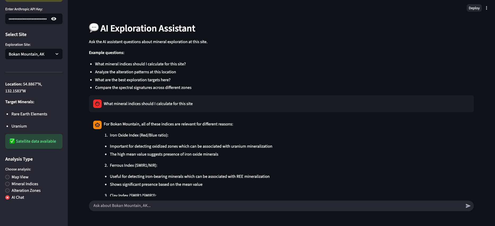

# GeoScout 🛰️

AI-powered mineral exploration platform using Sentinel-2 satellite imagery, LangGraph agents, and Claude AI.



## Overview

GeoScout analyzes satellite imagery for mineral exploration at three major sites:

- **Mountain Pass, CA** - Rare Earth Elements (REE) in carbonatite
- **Bingham Canyon, UT** - Porphyry copper-molybdenum-gold-silver
- **Bokan Mountain, AK** - REE and uranium in peralkaline granite

## Features

- 📡 **Satellite Data** - Sentinel-2 imagery download and processing
- 🤖 **AI Agent** - LangGraph agent powered by Claude for intelligent analysis
- 📊 **Mineral Indices** - Iron oxide, clay, ferrous, and vegetation indices
- 🗺️ **Interactive UI** - Streamlit web app with maps and visualizations
- 🔬 **Alteration Analysis** - Identify hydrothermal alteration zones
- 💬 **AI Chat** - Natural language queries about mineral exploration

## Quick Start

### 1. Install Dependencies

```bash
pip install earthengine-api geemap mcp langgraph langchain-anthropic streamlit folium streamlit-folium rasterio
```

### 2. Set Up API Key

```bash
# Copy the example file
cp .env.example .env.local

# Add your Anthropic API key to .env.local
# Get your key from: https://console.anthropic.com/
```

### 3. Download Satellite Imagery

```bash
# Register for Earth Engine first:
# https://console.cloud.google.com/earth-engine/

python download_sentinel2.py
```

### 4. Launch the App

```bash
cd geoscout
./run_app.sh
```

The app will open at `http://localhost:8501`

## Documentation

- **[GeoScout README](./geoscout/README.md)** - Complete documentation
- **[Quick Start Guide](./geoscout/QUICKSTART.md)** - Get started quickly
- **[Status](./geoscout/STATUS.md)** - Current status and test results

## Architecture

```
ako_earth/
├── download_sentinel2.py         # Download Sentinel-2 imagery
└── geoscout/
    ├── agent/
    │   └── mineral_agent.py      # LangGraph AI agent
    ├── mcp_server/
    │   └── server.py             # MCP server for data access
    ├── ui/
    │   └── app.py                # Streamlit web interface
    └── data/
        └── *.tif                 # Sentinel-2 GeoTIFF files
```

## Analysis Capabilities

### Mineral Indices
- **Iron Oxide** (Red/Blue) - Oxidized minerals, gossans
- **Clay Alteration** (SWIR1/SWIR2) - Hydrothermal alteration
- **Ferrous** (SWIR1/NIR) - Iron-bearing minerals
- **NDVI** - Vegetation cover

### AI-Powered Features
- Natural language queries
- Intelligent interpretation
- Exploration recommendations
- Alteration zone identification
- Multi-index analysis

## Technologies

- **AI:** Claude 3.5 Sonnet via Anthropic API
- **Framework:** LangGraph for agent orchestration
- **UI:** Streamlit with Folium maps
- **Data:** Sentinel-2 satellite imagery (ESA Copernicus)
- **Processing:** Rasterio, NumPy for geospatial analysis

## Security

- API keys are stored in `.env.local` (not committed to git)
- `.env.example` provides a template
- `.gitignore` protects sensitive files

## License

Educational and research purposes.
Sentinel-2 data courtesy of ESA Copernicus Program.

## Acknowledgments

Built with Claude Code by Anthropic.

---

For detailed instructions, see [geoscout/README.md](./geoscout/README.md)
